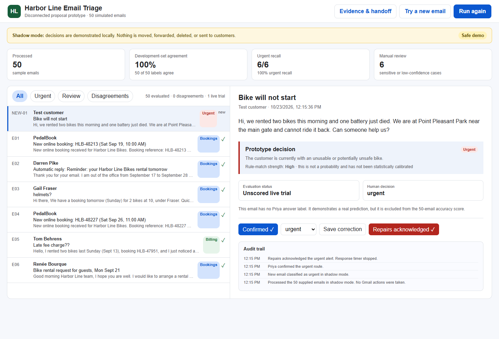

# Harbor Line Email Triage

An explainable, rules-based first version for sorting customer email into **Bookings**, **Repairs**, **Billing**, or **Urgent**. It is designed to work as a quiet layer inside Gmail instead of requiring staff to use another website.



## What is included

- `demo/` — a self-contained browser demonstration that processes the 50 simulated sample emails and reports agreement with Priya's supplied labels on every run.
- `gmail-addon/` — deployable Google Apps Script files and installation instructions for the Gmail add-on candidate.

Discovery notes, sprint paperwork, internal planning documents and unrelated project files are intentionally excluded.

## Run the demo

The simplest option is to download the repository and open `demo/index.html` in a browser. No server, login, external API or paid service is required.

With Node.js installed, you can instead run:

```powershell
cd demo
npm start
```

Then open `http://127.0.0.1:4174`.

## Verified first-version result

- 50 of 50 supplied emails processed.
- 50/50 agreement with Priya's labels on the development set.
- 6/6 supplied urgent messages found.
- 6 sensitive or lower-confidence messages held for review.
- 10 contextual/adversarial regression cases pass.
- The Gmail add-on candidate processed three invented messages in a real Gmail test account with 3 processed and 0 failed; a duplicate-safe rerun processed 0.

The 50/50 figure is **development-set agreement**, not independent accuracy. The sample emails helped shape the rules. A frozen test on previously unseen, independently labelled email is still required before making a production accuracy claim.

## How classification works

The classifier is deterministic and does not call an external AI service. It combines route evidence with a separate urgency check:

- booking language suggests Bookings;
- fault, damage and maintenance language suggests Repairs;
- charge, deposit, refund, invoice and receipt language suggests Billing;
- a current bike problem plus active safety, mobility or deadline impact can elevate the message to Urgent;
- historical or resolved wording helps prevent false urgent alerts;
- sensitive indicators and weak matches are sent to manual review.

Every prediction includes a human-readable reason.

## Gmail add-on

The add-on can label explicitly selected test messages, show the proposed route and reason, support corrections, avoid duplicate processing and store a metadata-only audit. It never deletes messages, moves them out of the inbox or sends automatic customer replies.

See [`gmail-addon/INSTALL.md`](gmail-addon/INSTALL.md) for the controlled test-installation process.

## Current limits

- It has not been connected to Harbor Line's live `hello@` inbox or approved for production.
- The current version does not send an SMS to the mechanic.
- Google limits the add-on's own scheduled trigger to hourly. A faster standalone trigger or Gmail push path is needed before promising a dependable under-one-hour alert.
- Production still requires administrator approval, an unseen-email evaluation, a named urgent responder and backup, and an agreed correction/fallback process.

## Run the automated checks

```powershell
cd demo
npm test
npm run test:adversarial
npm run evaluate
```

The browser smoke test additionally requires Playwright and Microsoft Edge in the local environment.

